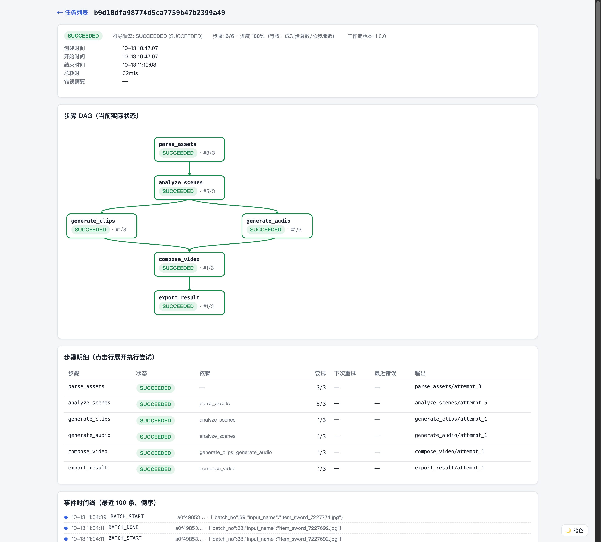
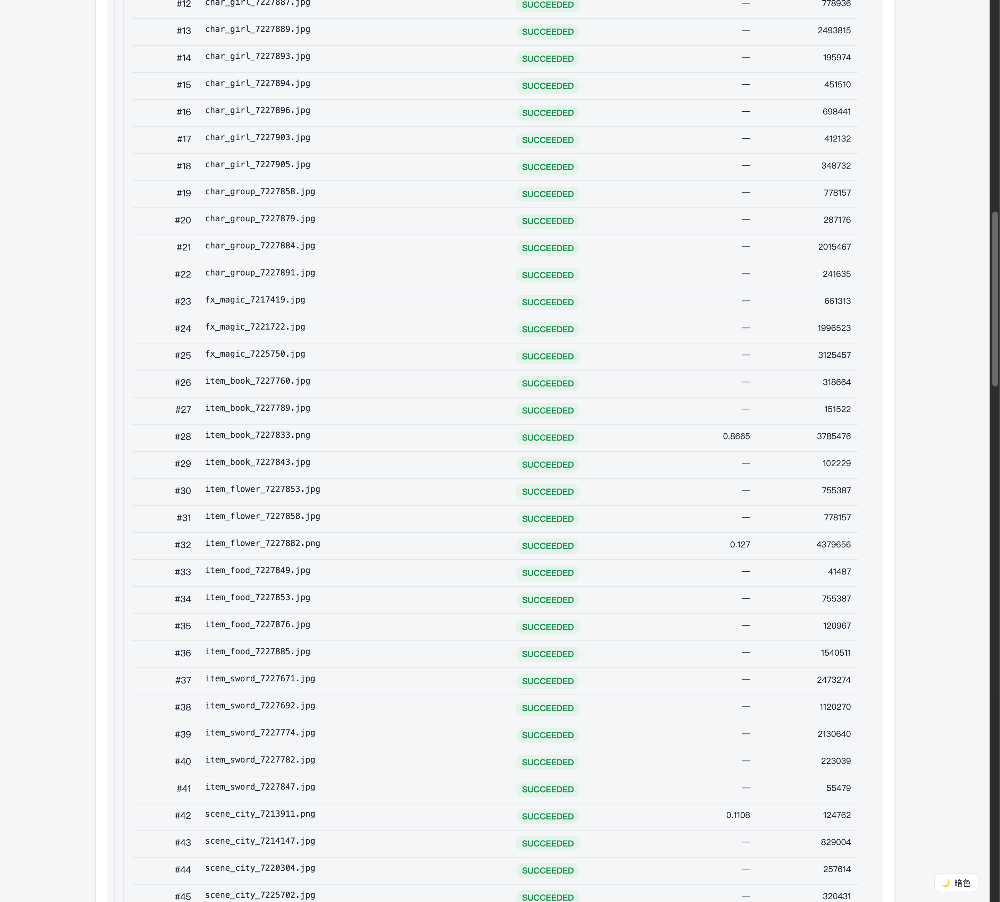
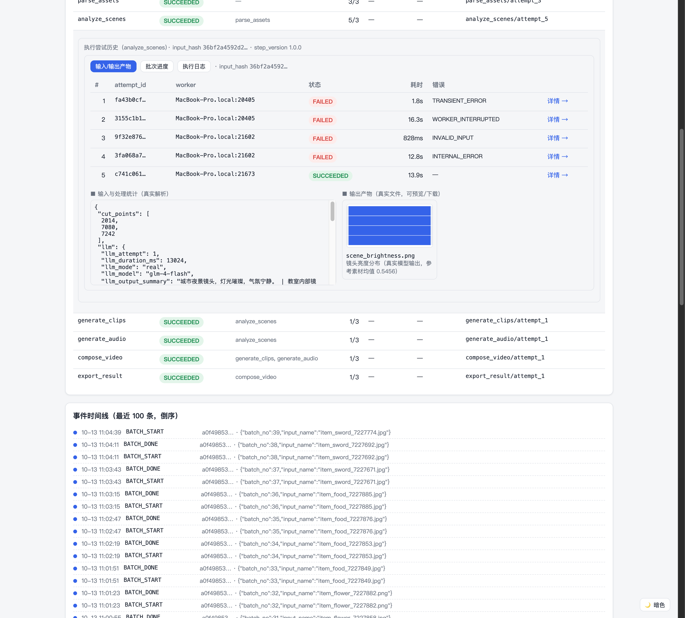
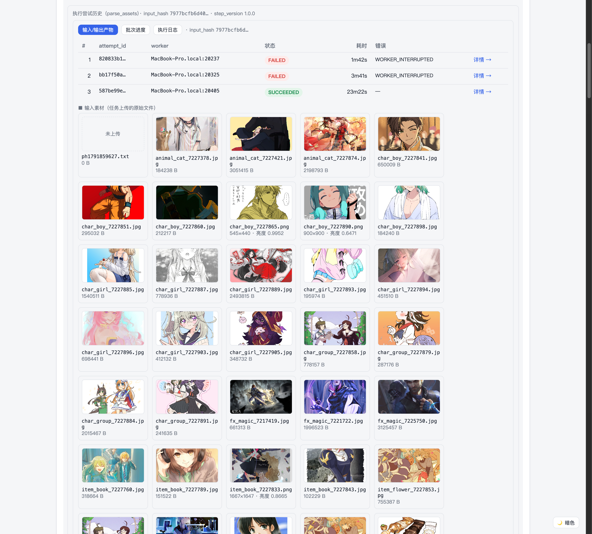

# RenderFlow — 可恢复、可观测的 AI 任务执行管线 MVP

动画素材处理场景的任务管线：任务由多个耗时步骤组成，单步失败可重试、Worker 进程中断可恢复、步骤结果可缓存复用，全程可观测。AI 应用开发岗位笔试项目（任务管线可观测方向）。

**公开仓库**：https://github.com/MrGendo/renderflow
**交付说明**：[SUBMISSION.md](SUBMISSION.md)（评审入口：设计取舍 / 真实性声明 / 测试与时间记录）
**运行证据**：[docs/evidence/](docs/evidence/README.md)——本地生产形态真实运行：8/8 检查通过（含真实 SIGKILL 恢复）+ 6 张界面截图 + Worker/API 日志（公网 Demo 待部署，见 SUBMISSION.md §10）
**API 文档**（本地启动后）：http://127.0.0.1:8900/api/docs

## 界面速览（真实任务截图，docs/screenshots/）

| 截图 | 内容 |
|---|---|
|  | **30 分钟长任务全景**（任务 b9d10dfa：62 张真·动漫素材 × 14 类，五故障演练后 6/6 SUCCEEDED，SVG 连线 DAG 全绿） |
|  | **批次检查点面板**——63 批逐行状态（DONE/复用），对应 task_batches 表；3 次 Worker 中断恢复中 16 批零重算 |
|  | **真实 LLM 节点详情**——analyze_scenes 展开：llm_source=real_model / glm-4-flash / 2640 tokens / 场景描述（城市夜景/教室/水面，与素材逐一对应）+ 输入输出产物 |
|  | **parse_assets 输入→输出全景**——62 张上传的原始动漫图网格（原图直出，含实测亮度标注）+ 每批缩略产物 + 真实解析统计（宽高/字节/亮度） |

更多证据（LLM 真实调用 JSON、四轮故障演练、动漫全链路）见 [docs/evidence/](docs/evidence/README.md)。

> 状态标记：✅ 已实现并有自动化测试覆盖 | 🧪 已实现（演示脚本/冒烟验证）| 📋 仅有设计方案（未实现）
> 一键验证：`make install && make test && make demo-all`

## 1. 背景与解决的问题

动画素材处理管线（解析→镜头分析→片段生成→音频→合成→导出）单任务耗时可达分钟到小时级。直接串行调用会遇到：单步失败整个任务重跑、Worker 崩溃后任务永久卡在中间态、上游无法回答"跑到哪一步/为什么失败/还要多久"、相同输入重复计算。RenderFlow 把每个步骤变成带租约、可重试、可恢复、可缓存的独立执行单元，以 SQLite 为唯一事实源，提供步骤级可观测性。

## 2. 功能清单

✅ 6 步 DAG 工作流（依赖校验、步骤级调度）
✅ **真实 LLM 任务节点**：analyze_scenes 调用 OpenAI 兼容 API（如 GLM/OpenAI），输入为上一步真实图片解析统计，输出结构化场景分析；无 Key 自动 Mock 模式（结果明确标记，不冒充真实）；下游步骤与 HTML 报告实际消费该结果；LLM 调用全程可观测（模型名/耗时/尝试次数/Token 用量/错误分类/重试原因），密钥不落日志
✅ 任务/步骤双层状态机（非法迁移拒绝、终态不可覆盖、下游 SKIPPED 防永久 RUNNING）
✅ 原子步骤领取（BEGIN IMMEDIATE 事务内 SELECT+UPDATE+INSERT attempt）
✅ 租约心跳 + 过期回收 + lease_version fencing（旧 Worker 提交被拒，T11）
✅ 7 类错误分类 → 差异化重试（指数退避+抖动、next_retry_at 持久化、重试上限、手动重试幂等）
✅ 结果缓存（四元组 cache_key、SHA-256 校验、命中走状态机记 CACHE_HIT、TTL 惰性清理）
✅ 故障注入（生效门 env，fail_first_n_attempts/always_fail/timeout_after_s/crash_worker/crash_first_n_attempts/max_attempts）
✅ 任务取消（请求与停止分离、RUNNING 检查点停止、重复取消 409）
✅ 事件表 + JSON 行式结构化日志（16 类事件）
✅ REST API + OpenAPI（/api/docs）
✅ React 前端三页面（列表/详情含 DAG/尝试详情、轮询降频 2s→10s、亮暗主题）
🧪 5 个演示脚本（正常/首败重试/真实 SIGKILL 重启恢复/缓存命中/重试耗尽+手动重试）
📋 GPU 调度、消息队列升级（见 §11 设计方案）

## 3. 架构与技术栈

```
┌──────────────┐   ┌──────────────────────────────────────────┐
│ React+TS+Vite │──▶│ FastAPI (renderflow.api)                 │
│ 3 pages, poll │   │  创建/查询/重试/取消/事件/健康检查          │
└──────────────┘   └────────────┬─────────────────────────────┘
                                │ 读写
                                ▼
                   ┌────────────────────────┐   ┌──────────────────┐
                   │ SQLite (WAL, 5 张表)    │◀──│ Worker 进程 ×N    │
                   │ tasks/task_steps/       │   │ 回收→领取→缓存→   │
                   │ step_attempts/          │   │ 执行→fencing 提交│
                   │ step_cache/task_events  │   └────────┬─────────┘
                   └────────────────────────┘            │
                                ▲     版本化输出+SHA256   ▼
                                └──── data/tasks/{tid}/steps/{type}/attempt_N/
```

后端：Python 3.11 + FastAPI + Pydantic v2 + sqlite3（标准库，手写 DAO）+ 独立 Worker 进程（python -m renderflow.worker）。前端：React 19 + TypeScript strict + Vite + 原生 CSS。无消息队列、无 Redis、无外部付费服务。

## 4. 任务 DAG 与状态机

DAG：parse_assets → analyze_scenes → {generate_clips ∥ generate_audio} → compose_video → export_result（compose 同时依赖 clips+audio；export 依赖 compose）。

任务状态机：PENDING → RUNNING → (RETRY_WAIT ↔ RUNNING) → SUCCEEDED | FAILED | CANCELLED（终态不可逆，所有终态 UPDATE 带 WHERE 守卫）。
步骤状态机：PENDING → READY → RUNNING → SUCCEEDED | RETRY_WAIT → RUNNING | FAILED | SKIPPED（另有 FAILED→READY 手动重试、SKIPPED→PENDING 依赖恢复复位）。

统一汇总函数 summarize_task（state_machine.py 单一实现，API 与 Worker 共用，无复制逻辑）：
取消请求且无运行步骤→CANCELLED；任一步骤 FAILED→FAILED（下游递归 SKIPPED，防永久 RUNNING）；任一 RETRY_WAIT→RETRY_WAIT；全部 SUCCEEDED→SUCCEEDED；有 RUNNING→RUNNING；否则按 started_at 判 PENDING/RUNNING。
进度 = SUCCEEDED 步骤数 / 总步骤数（等权）。明确说明：这是步骤完成度，不是模型生成进度。

## 5. 并发控制与恢复（核心设计）

**IMMEDIATE 事务 + 乐观租约（lease_version 作 fencing token）**：

- 领取（单事务）：BEGIN IMMEDIATE → 依赖推进（PENDING→READY，严格校验依赖全 SUCCEEDED）→ SELECT READY → UPDATE 为 RUNNING（WHERE status='READY'，校验 rowcount）→ INSERT attempt → COMMIT
- 数据库忙：busy_timeout=5000 + 指数退避重试（run_tx 内置，最多 5 次）+ 进程内 RLock（防同进程多线程嵌套事务）
- 心跳：执行器分片循环按 heartbeat_seconds 续租（touch_lease 带 worker_id+lease_version 双守卫）
- 过期回收：仅当 lease_until 真正过期才回收（租约即宽限期，不凭一次心跳缺失判死）；回收事务内 lease_version+1、补记旧 attempt 为 WORKER_INTERRUPTED、发 LEASE_EXPIRED+STEP_RECOVERED 事件、新 Worker 接管
- fencing：所有 RUNNING 态提交（成功/失败/心跳/缓存/取消中止）SQL 带 worker_id+lease_version；不匹配抛 LeaseLostError，旧 Worker 记 STEP_FENCED 后彻底放弃，绝不回滚新持有者状态

**执行语义的诚实声明**：不承诺恰好一次。外部操作可能成功而状态未及记录（at-least-once 风险窗口）。缓解：版本化不可变输出路径（attempt_N 目录互不覆盖）+ SHA-256 校验和 + fencing 拒绝过期提交。补偿/事务性外发未实现（见 §10 限制）。

## 6. 数据模型

五表见 backend/renderflow/db.py（SCHEMA_MIGRATIONS 列表式迁移 V1/V2，启动幂等执行，python -m renderflow.db 手动初始化）：
tasks、task_steps（UNIQUE(task_id,step_type)、INDEX(status,lease_until)）、step_attempts（UNIQUE(step_id,attempt_no)）、step_cache（cache_key PK、INDEX(expires_at)）、task_events（INDEX(task_id,created_at)）。外键 ON DELETE CASCADE。心跳不逐条入库：task_steps.heartbeat_at 覆盖式更新（只保留最近），完整诊断走 JSON 行式文件日志（data/logs）。时间戳存 UTC epoch REAL，API 层转 ISO8601。

## 7. 安装 / 启动 / 测试

```bash
make install        # backend: uv venv(3.11) + pip install -e ".[dev]"；前端: npm install（frontend/）
make dev-api        # uvicorn renderflow.api:app --port 8900
make dev-worker     # python -m renderflow.worker（独立进程，可起多个）
# 前端：cd frontend && npm run dev  → http://localhost:5173（已配代理到 8900）
make test           # pytest -q（32 个测试：26 管线 + 6 LLM 节点）
make demo-1 ... demo-5 / demo-all
```

**启用真实 LLM（可选）**：复制 .env.example 为 .env，配置三个环境变量：
`RENDERFLOW_LLM_BASE_URL`（如 https://open.bigmodel.cn/api/paas/v4）、`RENDERFLOW_LLM_MODEL`（如 glm-4-flash）、`RENDERFLOW_LLM_API_KEY`（只经环境变量注入，勿提交）。API 与 Worker 进程都要读到这些变量。三项任一为空时自动运行 Mock 模式——Mock 输出恒定带 `[MOCK]` 标记与 `llm_source=mock` 元数据，与真实模型结果（`llm_source=real_model`，含真实 Token 用量）在任何界面/报告/日志中均可区分。
停止：Ctrl+C / kill（Worker 收 SIGTERM 后完成当前步骤优雅退出）。OpenAPI 文档：http://127.0.0.1:8900/api/docs

## 8. 故障注入演示（真实输出可复现）

```bash
make demo-1  # 正常任务：PENDING→RUNNING→SUCCEEDED，6 步各 1 次 attempt
make demo-2  # generate_clips 前 2 次 TRANSIENT 失败：RETRY_WAIT→SUCCEEDED，3 次 attempt 历史保留
make demo-3  # 真实 SIGKILL 执行中 Worker → 租约过期 → 新 Worker 接管：
             #   attempt#1 WORKER_INTERRUPTED（回收器补记）→ attempt#2 SUCCEEDED，
             #   LEASE_EXPIRED+STEP_RECOVERED 事件在案，已成功步骤零重跑
make demo-4  # 任务B相同输入 CACHE_HIT×6（worker=cache，0ms，输出引用指向任务A产物）；任务C改输入 0 命中
make demo-5  # 重试耗尽（max_attempts=1）→ 任务 FAILED + 下游 SKIPPED → 手动重试 → SUCCEEDED
```
注入格式：POST /api/tasks 的 fault_injection 字段，如 {"generate_clips": {"fail_first_n_attempts": 1, "failure_type": "TRANSIENT_ERROR"}}；仅在 RENDERFLOW_ALLOW_FAULT_INJECTION=1 时生效（默认 0，生产请求注入被忽略并在响应中标注）。

## 9. 自动化测试结果（2026-10-12 实际运行）

**32+3 passed**（26 管线 + 6 LLM 节点 + 3 批次检查点；LLM 测试用本地假 OpenAI 端点，Mock 测试验证标记不冒充）。真实外部模型调用：✅ 已验证（glm-4-flash，见 docs/evidence/llm_real_call_evidence.json）。

| 文件 | 覆盖 |
|---|---|
| test_basic_flow.py | T1 正常全流程（含逐文件 SHA-256 校验+事件断言）/ T2 状态一致+进度单调 / T3 依赖时序 / T4 查询+404 |
| test_retry.py | T5 首败后成 / T6 不可重试直败 / T7 重试上限终止 / T8 上游失败下游不执行 |
| test_recovery.py | T10 过期租约重领 / T11 fencing 拒绝旧提交（异常+DB 双验证） |
| test_process_recovery.py | T9 真实 SIGKILL 恢复 / T9b crash 注入重启 / T9c 双真实 Worker 并行（6 步恰 6 次领取）/ T9d 中断后重连历史完整 |
| test_cache.py | T13 命中 / T14 输入变失效 / T15 版本变失效 / T16 文件损坏清行 |
| test_concurrency.py | T17 两 Worker 恰好一次 / T18 十并发重试幂等 / T19 busy 渡锁 |
| test_llm.py | Mock 标记不冒充 / 本地假端点真实调用（Bearer+Token 用量+密钥不落日志）/ 429 限流重试 / 非法输出重试 / 限流耗尽→FAILED→手动恢复 / LLM 调用中 Worker SIGKILL 恢复 |
| test_batches.py | W6：5 批次中途 SIGKILL→重启→已完成批次复用不重跑 / fail_at_batch 一次性失败→重试复用 / crash_at_batch 批次崩溃→恢复复用 |
| test_cancel.py | T20a 取消 / T20b 终态 409 / T20c 取消绝不误标成功 + RUNNING 检查点取消 |

前端：tsc -b && vite build 零错误；三页面经无头 Chrome + 真实后端联调验证（列表 3 任务真实数据、详情 DAG/事件时间线、尝试详情页含缓存命中证据链）。
未覆盖场景（如实说明）：跨机器多主机并发（单机环境限制）、真实 GPU/小时级任务（题目允许 MOCK）、前端自动化 E2E（人工+CDP 脚本验证代替）。

## 10. 已知限制与失败案例分析

- AttemptDetail 页曾遍历任务列表查 attempt → W5 已补 GET /api/attempts/{id} 直达
- INTERNAL_ERROR 保守视为不可重试（宁可人工介入，避免未知错误风暴重试）
- 故障注入靠 env 生效门，但同一 env 下无法按用户/来源二次隔离（生产应彻底关闭该 env）
- run.log 无轮转（长任务日志增长无上限）；task_events 无归档清理
- 取消不能硬杀正在执行的分片 sleep 之外的系统调用（取消延迟 ≤ 一个 tick 100ms + 检查点粒度）
- 失败案例（开发中实际踩到）：① crash_worker 原为无条件崩溃 → 重启后永远无法完成，补 crash_first_n_attempts；② 同输入任务瞬间被缓存完成导致取消测试误报 → 测试改用唯一输入；③ Vite dev 只绑 IPv6 localhost → Chrome 用 127.0.0.1 连接被拒，改 localhost 访问；④ 并发手动重试暴露 FastAPI 线程池共享 sqlite 连接的嵌套事务错误 → run_tx 加进程内 RLock

## 11. 秒级→小时级任务与 GPU 调度（设计方案，未实现 📋）

已实现部分（MVP 内）：心跳续租按 heartbeat_seconds 节流（长任务自动覆盖）；步骤 timeout_s 熔断；租约宽限期可配；checkpoint 式取消检查点。

未来扩展（仅设计）：
1. 长步骤心跳：GPU 任务建议 lease=5×heartbeat，续租失败降级为"暂停接单"而非立刻放弃
2. 失联 vs 网络抖动：连续 N 次心跳失败进入 SUSPECT（仍持有租约），超过宽限期才回收——比单次缺失更稳
3. 检查点恢复：生成类步骤（分片渲染）可存 part_N 产物续跑；合成/导出类只能整段重执行但复用上游缓存
4. GPU 记录：task_steps 加 gpu_type/device_id/vram_required/queued_at/started_at → 排队时间与执行时间可算
5. GPU 错误分类：GPU_UNAVAILABLE(资源)/OOM(可换卡重试)/MODEL_LOAD_FAILED(不可重试)
6. 调度：Worker 注册 GPU 能力表，领取 SQL 加资源过滤（WHERE vram_ok AND gpu_type IN (...)）
7. 配额防过载：每 GPU 并发上限 + 每用户小时级配额表
8. 何时升级：SQLite 写锁成为瓶颈（Worker>10 或 QPS 高）、需要跨机分发、需要优先级队列/死信 → 换 Postgres+Redis 队列或 Temporal/Airflow；当前轮询式调度在单机小规模下最简且够用

## 12. AI Coding 工具与 Token 用量（实际记录）

| 波次 | 执行者 | turns | 耗时 | input/output/cache_read tokens | 计费 |
|---|---|---|---|---|---|
| W1 后端核心 | Claude Code (glm-5.3) | 43 | 25.3min | 114,026 / 72,953 / 2,685,632 | $3.76 |
| W2 重试/恢复 | Claude Code (glm-5.3) | 123 | 29.4min | 113,470 / 101,680 / 9,787,328 | 未统计（GLM 订阅） |
| W3/W4/W5 | Hermes (GLM-5.3 会话) | — | — | 无法准确获取 | 订阅内 |

Token 消耗较多的部分：W2（长任务书+多轮测试修复循环，cache_read 近千万）。开发时间线（git 实录）：11:38 环境检查→12:16 W1→12:46 W2→13:01 W3→13:09 W4→W5 收尾。**时间花费最多：W2 重试/fencing 语义设计与验证（约 32 分钟委派+多轮人工冒烟）**。

## 13. 已实现 vs 仅设计

已实现并测试：DAG 调度/状态机/原子领取/租约回收/fencing/重试/缓存/故障注入/取消/手动重试/事件可观测/API/前端三页面/真实进程恢复测试/5 演示脚本。
已实现未深测：多 Worker 扩展性（2 Worker 已测，更多未测）。
仅设计：GPU 调度（§11.4-7）、消息队列/工作流引擎升级（§11.8）、日志轮转归档、多用户认证（MVP 无鉴权，单机演示用）。

## 14. 公网部署步骤（清单）

方案 A（推荐，Render Blueprint）：Render.com 控制台 New → Blueprint → 导入本仓库——render.yaml 自动创建单服务（Docker：API+独立 Worker 进程）+ 1GB 持久盘 /data（SQLite+产物），健康检查 /api/health，ALLOW_FAULT_INJECTION=0。
方案 B（任意容器平台）：docker build -t renderflow . && docker run -p 10000:10000 -v rfdata:/data renderflow（Dockerfile 多阶段构建：前端产物由 FastAPI 托管，单域名免 CORS）。
验证清单：/api/ready 200 → 前端首页可开 → 提交任务跑通 → 容器内 kill Worker 进程验证恢复（对应 demo-3 场景）。
注意：本 MVP 无多用户鉴权，公网演示请用隔离环境与最小数据，不要开放生产数据写入。
