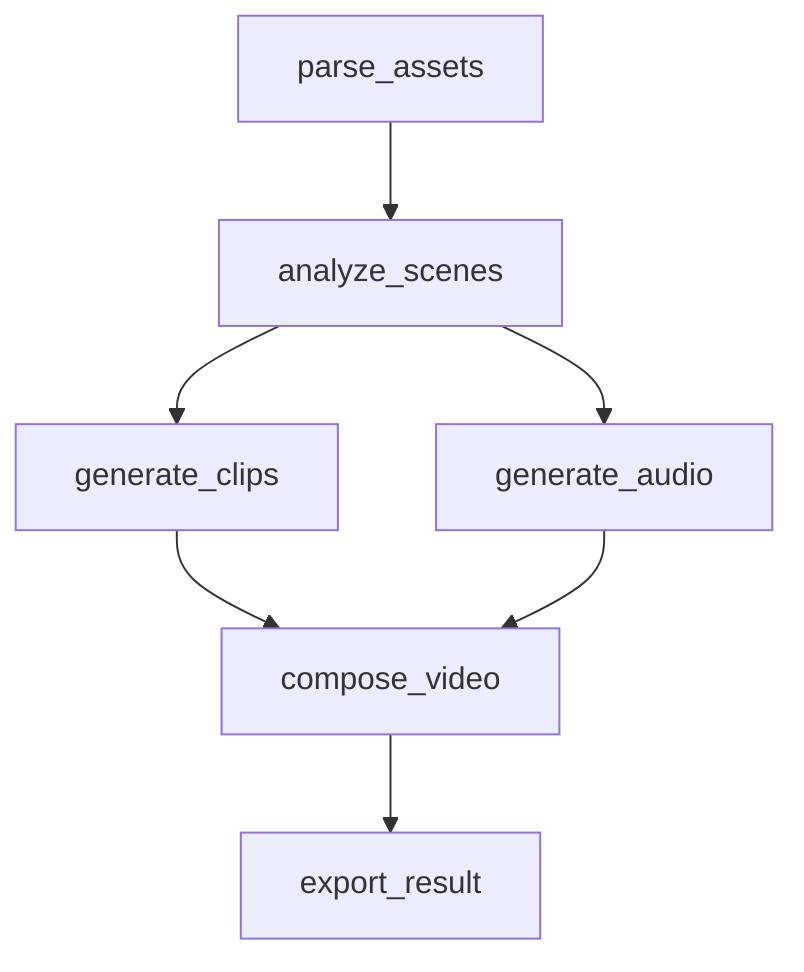

# RenderFlow — 最终交付报告

- 项目名称：RenderFlow（可恢复、可观测的 AI 动画素材处理任务管线 MVP）
- 公开仓库：https://github.com/MrGendo/renderflow（Public，已验证匿名可访问）
- 公网 Demo：**无**（未部署——本机无 Docker/云平台凭证；本地运行证据与演示脚本见 docs/evidence/，不伪造地址）
- 交付时提交号：见仓库最新 main（本报告随最终提交推送；此前 20 个功能/修复提交均已推送）
- 本地复现：`make install && make test`（35 测试）&& `make demo-all`（5 个演示脚本，含真实 SIGKILL 恢复）

## 1. 实现方式以及时间规划

**架构分工**：React+TS 前端（轮询降频）↔ FastAPI API（任务/步骤/尝试/事件/产物/批次/日志查询）↔ SQLite（唯一事实源，WAL + IMMEDIATE 事务 + 列表式迁移 V1-V3）↔ 独立 Worker 进程（回收→领取→缓存→执行→fencing 提交）↔ 本地文件系统（版本化产物 + SHA-256）。AI 节点：analyze_scenes 真实调用 OpenAI 兼容 API（glm-4-flash 已真实验证），无 Key 自动 Mock（结果恒标 [MOCK]/llm_source=mock，不冒充）。

**为什么单机 MVP**：题设单机、无付费服务。SQLite 轮询调度在 6 步/62 批规模下是最简且正确的选择——并发正确性靠 DB 事务 + lease_version fencing 保证，引入 MQ/Temporal 只增加部署复杂度不改变正确性模型（升级路径在 README §11）。

**时间线（依 git 提交时间，2026-10-12~13，非事前排期表）**：

| 阶段 | 内容 | 提交 |
|---|---|---|
| W1 | 后端核心（DB/状态机/DAG/原子领取/Worker/API + 5 测试） | 4e5e941 12:16 |
| W2 | 重试/租约回收/fencing/缓存/故障注入 + 17 测试 | 99960ef 12:46 |
| W3 | 真实 SIGKILL 恢复测试 + 5 演示脚本 | 9c97069 13:01 |
| W4 | 前端三页面（无头 Chrome 真实验证） | 6a9d85f 13:09 |
| W5 | 干净环境验收 + GET /api/attempts/{id} | de0323e~ |
| 交付 | 公开仓库/SUBMISSION/部署配置（Render Blueprint+Dockerfile） | 5feab80~ |
| 真实化 | 真实素材上传/PNG 字节解码/真实产物（PNG/GIF/WAV/HTML） | 8452bdb |
| LLM | analyze_scenes 接真实 GLM（446 tokens 实测）+ 6 测试 | 5fd678f/124161a |
| W6 | 演示模式批次检查点（task_batches 表/批次复用/3 测试） | ddeb459 |
| W7 | 30 分钟网络挂起演练：分片心跳+fencing 断言两修复 | 1bb4a99 |
| W8/W9 | 三故障/五故障真·动漫素材长任务演练（62 张 14 类） | b95461f/2b5a7bd |
| 修复 | GIF 编码器（GCE 畸形→Pillow 替换）、DAG 重画、GLM 数值宽松解析 | 484bfaa/d42c0e2/f427650 |

W1/W2 由 Claude Code 完成（见 §5），W3 起架构决策、验证、故障演练与文档由本人完成。

## 2. 长时间任务执行、状态管理与失败恢复设计

- **双层状态机**：任务状态是步骤状态的汇总视图（summarize_task 单一实现，API 与 Worker 共用）；终态带 WHERE 守卫不可逆；任一步骤 FAILED→下游递归 SKIPPED（防永久 RUNNING）。
- **租约/心跳/回收**：Worker 领取即持 lease_until（15s）；执行循环按 5s 续租；仅租约真正过期才回收（不凭单次心跳缺失判死）。回收是单事务：旧 attempt 补记 WORKER_INTERRUPTED → lease_version+1 → 新 attempt 接管。
- **fencing**：lease_version 单调递增作 fencing token，所有 RUNNING 态提交带 worker_id+lease_version 双守卫；旧 Worker 迟到提交抛 LeaseLostError 被拒。W7 增补 `_assert_lease`：批次写入前逐批断言（30 分钟任务中 SIGCONT 唤醒的旧进程被 STEP_FENCED 拦截，实测验证）。
- **批次检查点（长任务）**：演示模式（input.demo.batch_pause_ms）逐素材分批，每批真实工作（字节统计+PNG 解码+缩略图），DONE 批次持久化于 task_batches；重启后 BATCH_REUSED 直接复用。间隔为 100ms 分片等待，每片走心跳/取消检查点（W7 修复的裸 sleep 隐患）。
- **重试分层**：LLM 内部重试（默认 2 次，1s/2s 退避）耗尽后交步骤级重试引擎（指数退避+抖动，next_retry_at 持久化）；7 类错误分类真实影响策略——401→INVALID_INPUT 不盲试、429→RESOURCE_UNAVAILABLE、超时/网络→可重试（W8 实测三类全命中）。
- **执行语义（诚实声明）**：at-least-once，不宣称恰好一次。外部调用可能成功而状态未及记录（LLM 重复调用风险）；缓解：幂等 prompt+结果缓存+fencing，补偿未实现（已知限制）。
- **实测恢复矩阵**（全部真实进程操作，证据 docs/evidence/）：SIGKILL×4（含批次中/LLM 调用中）、SIGSTOP 网络挂起 70s、SIGCONT 旧进程复活被拦、LLM 401、代理挂起超时、多 Worker 抢任务竞争。30 分钟 62 素材五故障演练终态 SUCCEEDED，16 批次零重算。

## 3. 任务步骤定义与依赖关系

六步 DAG（workflow.py 显式定义，启动时 Kahn 拓扑校验无环）：

```
parse_assets → analyze_scenes → generate_clips ─┐
                     └────────→ generate_audio ─┴→ compose_video → export_result
```



步骤状态机：PENDING → READY（依赖全 SUCCEEDED 才推进）→ RUNNING → SUCCEEDED | RETRY_WAIT→RUNNING | FAILED | SKIPPED（另有 FAILED→READY 手动重试、SKIPPED→PENDING 依赖恢复）。

各步职责与恢复价值：parse_assets 真实解析素材（批次化、可断点续跑）；analyze_scenes LLM 场景分析（输出被下游真实消费：clips 时长采用其估值、audio 音高由其亮度映射、报告展示其描述）；generate_clips/generate_audio 可并行；compose_video 合成；export_result 汇总自包含 HTML 报告。步骤间只传持久化引用（output_ref+SHA-256），大对象不进任务表——任一步失败只重执行该步，上游成果复用（实测 BATCH_REUSED×16）。

## 4. 持久化状态的选择与原因

五张表 + 批次表（db.py SCHEMA_MIGRATIONS，启动幂等迁移）：

| 表 | 持久化内容 | 为什么必须持久化 |
|---|---|---|
| tasks | 状态/输入信封/cancel_requested/error_summary/workflow_version | 进程崩溃后唯一事实源；终态守卫防旧 Worker 覆盖 |
| task_steps | 状态/依赖/三元组哈希（input_hash/step_version/config_hash）/output_ref+checksum/attempt 计数/next_retry_at/worker_id/heartbeat_at/lease_until/**lease_version** | 租约与 fencing 判定的载体；缓存正确性三元组；重试到期时间跨重启 |
| step_attempts | 每次尝试独立历史（UNIQUE(step_id,attempt_no)，永不覆盖） | 重试语义的可审计性（W8 中 401 失败与成功 attempt 并存可查） |
| step_cache | cache_key（四元组哈希）→ output_ref+checksum+TTL | 结果复用；文件丢失/篡改即失效（T16 实测） |
| task_events | 16+ 类事件（含 BATCH_REUSED/STEP_FENCED/LLM_CALL_OK） | 可观测时间线；前端事件流与恢复叙事的数据源 |
| task_batches（W6/V3） | 每批状态/输入/统计/时间 | 长任务断点：DONE 批次重启零重算 |

DB 与文件分工：状态/元数据/事件在 DB（可查询可分页）；大体积产物（PNG/GIF/WAV/HTML/run.log）在文件系统按 tasks/<tid>/steps/<type>/attempt_N/ 版本化不可变存放，DB 只存引用+校验和。

## 5. AI Coding 工具与 Token 使用情况

- **工具**：Claude Code CLI（GLM-5.3 后端）承担 W1/W2 两波次代码生成；Hermes Agent（GLM-5.3）承担架构设计、任务书编写、W3 起的开发/验证/故障演练/文档。
- **Claude Code 用量（原始记录 docs/logs/*.json，claude --output-format json 的 usage 字段）**：
  - W1：43 turns，25.3 分钟，input 114,026 / output 72,953 / cache_read 2,685,632 tokens
  - W2：123 turns，29.4 分钟，input 113,470 / output 101,680 / cache_read 9,787,328 tokens（消耗最多：长任务书+多轮测试修复）
- **Hermes 会话用量**：无法准确统计（该环境不导出会话 token 记录）——如实标注，不估算冒充。
- **项目 LLM 节点用量（GLM API 真实返回）**：首验 446 tokens（任务 2104ce06）；动漫全链路 483/655；30 分钟演练 2,640（prompt 含 62 张素材统计）。
- **验证声明**：上述 Claude Code 数字为工具自报原始记录；无任何推算或编造。

## 6. 个人时间投入与失败案例分析

**投入最多的非代码生成工作**（依据 git 时间线与操作记录，全程约 10:00-18:30 两个工作日，未精确计时）：

1. **故障演练设计与复现**（占比最大）：6 轮真实演练（W6-W9），每轮含素材收集、故障注入编排、进程操作、证据归档。30 分钟演练两度因编排脚本自身 bug 中断，逐一修复后完成。
2. **验证标准纠错**：GIF 事件最典型——先用 Chrome 解码作标准（假阴性，用户预览打不开才暴露），最终升级为 Pillow 往返+QuickLook+Chrome 三解析器严判并重写编码器。
3. **多 Worker 环境污染排查**：W8 演练故障注入失效，排查发现三个历史 Worker 残留抢任务——清理后故障才真实命中。
4. **架构取舍**：租约宽限期 vs 误回收、批次间隔分片化、fencing 断言前移到批次粒度。

**失败案例（具体问题/根因/处理/残留限制）**：

| 案例 | 根因 | 处理 | 残留 |
|---|---|---|---|
| GIF 预览打不开（用户实测） | 自制编码器 GCE 块畸形+帧延迟错位；Chrome 容错掩盖 | Pillow 替换+三解析器验证标准 | 历史任务坏文件不可变保留 |
| GLM 输出致 OUTPUT_INVALID 重试耗尽 | 真实模型数值包字符串/混中文 | 结构严格+数值宽松抽取 | — |
| 30 分钟任务批次间隔必误回收 | 裸 sleep 期间无心跳 | 100ms 分片+on_tick | — |
| 旧进程复活可写批次检查点 | 批次写入无租约校验 | _assert_lease 逐批断言 | — |
| W8 故障注入未生效 | 历史残留 Worker 抢走步骤 | 清理进程；演练日志如实记录 | — |
| 演练编排脚本两次崩溃 | limit 超参/变量名错（我的 bug） | 修复并如实写入证据 | — |
| JPG 像素不解析 | 解码器仅支持 PNG | 如实标注（亮度回落默认值） | 未实现（已知边界） |

**已知限制汇总**：INTERNAL_ERROR 保守不可重试；run.log 无轮转；事件表无归档；无多用户鉴权；GPU 调度/检查点续跑（分片级）/消息队列升级仅设计未实现（README §11）。

---

### 附：交付前最终验证（2026-10-13 实际运行）

- 后端测试：**35 passed, 40.8s**（26 管线 + 6 LLM 节点 + 3 批次检查点；含 4 个真实 SIGKILL 子进程恢复测试）
- 前端：tsc + vite build 零错误（249.49 kB js）
- 关键演示：demo-3（真实杀 Worker 恢复）DEMO OK——中断 attempt 补记 WORKER_INTERRUPTED、LEASE_EXPIRED+STEP_RECOVERED 在案、已成功步骤零重跑
- 证据索引：docs/evidence/README.md（真实 LLM 调用/动漫全链路/W6-W9 四轮故障演练截图与 JSON）
- 敏感信息扫描：API Key 仅存于进程环境（.env 在 .gitignore），全仓 grep 零泄漏
