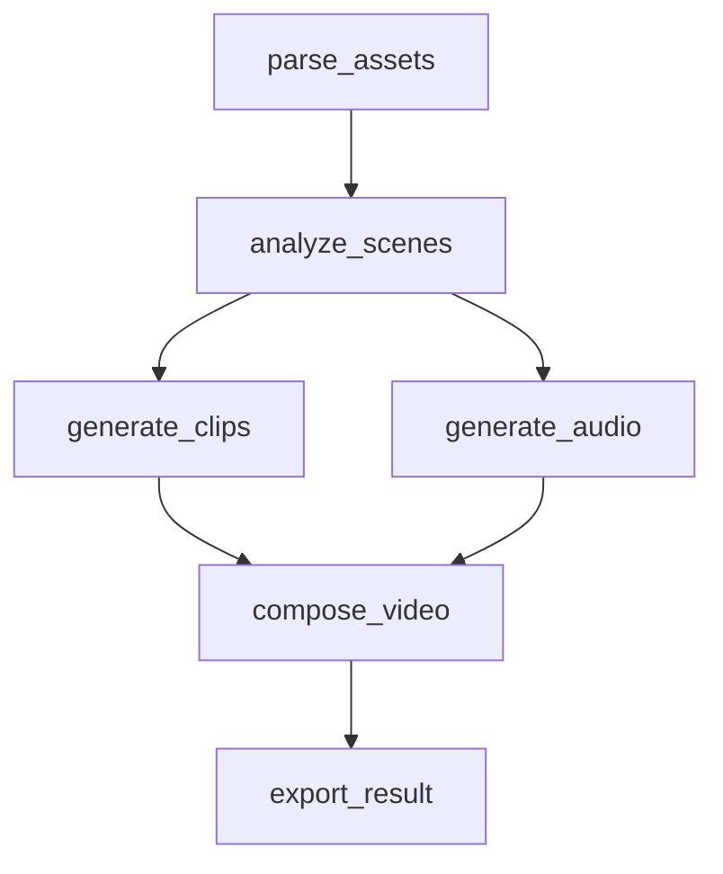

# RenderFlow 笔试交付说明（SUBMISSION）

> 本文档供评审快速理解项目。只描述实际完成并经过验证的内容；设计方案与未来规划单独标注。
> 生成日期：2026-10-12（发布当日重新运行了全部测试与演示，结果见 §9）。

## 1. 项目与交付地址

- 项目名称：RenderFlow
- 一句话介绍：可恢复、可观测的 AI 动画素材处理任务管线 MVP——步骤级租约调度、失败重试、进程中断恢复、结果缓存与全程可观测。
- 公开源码仓库：https://github.com/MrGendo/renderflow（Public，已验证匿名可访问仓库页/README/前后端源码/测试/演示脚本）
- 公网 Demo：**待部署**（部署配置已备好：render.yaml + Dockerfile + start_prod.sh；阻塞原因与所需操作见 §10，未编造 URL）
- API 文档（本地运行后）：http://127.0.0.1:8900/api/docs（FastAPI 自动生成 OpenAPI）
- 测试与演示说明：仓库 README §7-§9（make test / make demo-1..5）

## 2. 实现方式与时间规划

分工：React+TS 前端（轮询 2s/10s 自适应）↔ FastAPI API（创建/查询/重试/取消/事件）↔ SQLite（唯一事实源，WAL+IMMEDIATE 事务）↔ 独立 Worker 进程（回收→领取→缓存→执行→fencing 提交）↔ 本地文件系统（版本化产物 + SHA-256）。

为什么单机 MVP：题目要求单机、无付费外部服务；任务规模（6 步、秒级 MOCK）下 SQLite 轮询调度是最简单且正确的选择——引入 Redis/Celery/Temporal 只会增加部署复杂度却不改变正确性模型（并发控制仍靠 DB 事务与 fencing token）。

阶段划分（说明：这是按实际开发顺序的事后整理，并非事前排期表；时间来自 git 提交记录，为每个波次的有效工作时长下界）：

| 阶段 | 内容 | 实际情况 |
|---|---|---|
| W1 | DB/状态机/DAG/API/Worker 核心 + T1-T4 | 完成，12:16 提交 |
| W2 | 重试/租约回收/fencing/缓存/故障注入 + 17 测试 | 完成，12:46 提交 |
| W3 | 真实 SIGKILL 恢复测试 + 5 演示脚本 | 完成，13:01 提交 |
| W4 | 前端三页面 + 无头浏览器真实验证 | 完成，13:09 提交 |
| W5 | 干净环境验收 + README 实数据 | 完成（含本次发布前重跑） |

## 3. 长时间任务、状态管理与失败恢复

- 独立 Worker：Web 进程只读写 DB，不做计算——API 重启不影响执行中任务，Worker 崩溃不影响查询。
- 双层状态机：任务状态是步骤状态的汇总视图（统一函数 summarize_task，单一实现），二者职责分离——步骤管执行事实（attempt/租约/重试），任务管用户视角（进度/终态/取消）。终态带 WHERE 守卫不可逆，杜绝旧 Worker 或重复请求覆盖。
- 租约/心跳/回收：Worker 领取时获得 lease_until；执行分片循环按 heartbeat_seconds 续租；只有 lease_until 真正过期才回收（租约即宽限期，不凭单次心跳缺失判死）。回收是单事务：补记旧 attempt 为 WORKER_INTERRUPTED → lease_version+1 → 新 attempt 接管。
- fencing：lease_version 单调递增作 fencing token，所有 RUNNING 态提交（成功/失败/心跳/缓存/取消）SQL 带 worker_id+lease_version 双守卫；旧 Worker 迟到的提交抛 LeaseLostError 被拒（测试 T11：异常抛出 + DB 未被覆盖双断言）。
- 重试设计：7 类错误分类——TRANSIENT/TIMEOUT/RESOURCE_UNAVAILABLE/WORKER_INTERRUPTED 可重试（指数退避 base·2^(n-1) 封顶 + 抖动，next_retry_at 持久化）；INVALID_INPUT/OUTPUT_INVALID/INTERNAL_ERROR 不可重试直接 FAILED（INTERNAL_ERROR 保守处理，见 §8）。每步独立 max_attempts，耗尽后下游递归 SKIPPED 防任务永久 RUNNING。
- 进程中断恢复：SIGKILL 后步骤停留 RUNNING+租约过期 → 任意存活/新起 Worker 的回收路径接管 → 从该步骤继续，已成功步骤零重跑（真实子进程测试 T9 与演示 demo-3 验证）。
- 恰好一次的诚实声明：不做此宣称。外部操作可能成功而状态未及记录（at-least-once 窗口）。缓解：版本化不可变输出路径（attempt_N 目录互不覆盖）+ SHA-256 校验 + fencing 拒绝过期提交。事务性外发/补偿未实现。
- 恢复边界：能恢复=步骤级（MOCK 执行无外部副作用）；真实生成类步骤若自身不可续跑，恢复=重执行该步骤+复用上游缓存产物。

## 4. 任务步骤和依赖关系

六步：parse_assets（素材解析）→ analyze_scenes（镜头分析）→ generate_clips（片段生成）∥ generate_audio（音频生成）→ compose_video（合成）→ export_result（导出）。

独立性的原因与恢复价值：每步输入=任务输入+上游产物的确定性摘要，输出=独立版本化文件——任一步失败只需重执行该步（秒级），上游分钟级计算成果通过 output_ref+checksum 复用；clips 与 audio 无相互依赖可并行，是最能体现 DAG 收益的分叉点。

## 5. 持久化状态与原因（真实表结构，源码 db.py）

| 表 | 用途 | 关键字段 |
|---|---|---|
| tasks | 任务状态与汇总 | status, input_json, cancel_requested, error_summary, workflow_version, created/started/finished_at |
| task_steps | 步骤执行事实 | status, dependencies(JSON), input_hash, step_version, config_hash, output_ref+checksum, attempt_count/max_attempts, next_retry_at, worker_id, heartbeat_at, lease_until, lease_version, error_code/message |
| step_attempts | 每次尝试的完整历史 | attempt_no, worker_id, status, duration_ms, error_code/message, log_ref, output_ref（UNIQUE(step_id,attempt_no)，历史永不覆盖） |
| step_cache | 结果缓存元数据 | cache_key(=四元组哈希) PK, output_ref+checksum, expires_at |
| task_events | 状态事件流（第五张表） | event_type(16 类), step/attempt/worker 关联, duration_ms, error_code, detail_json |

为什么持久化：任务/步骤状态——进程崩溃后唯一事实源；next_retry_at——Worker 重启后仍知道何时再试；心跳与租约——判定失联与回收的依据；lease_version——fencing 的载体；input_hash/step_version/config_hash——缓存正确性三元组（任一变化即失效）；output_ref+checksum——文件与 DB 的完整性绑定（文件丢失/篡改即缓存失效）；错误与时间——失败原因查询与耗时分析。

DB 与文件分工：状态/元数据/事件在 DB（可查询）；大体积产物与逐 tick 诊断日志在文件（run.log JSON 行式 + output.json）；step_attempts 只存引用（log_ref/output_ref），不存内容。

## 6. AI Coding 工具与 Token 用量（如实）

实际使用：Claude Code CLI（后端 GLM-5.3 后端）完成 W1/W2 两个波次；Hermes Agent（GLM-5.3）承担架构设计、任务书编写、W3/W4/W5 开发与全部验证。

可获取的 Token 统计（来源：claude -p --output-format json 的 usage 字段原始记录，存于 docs/logs/）：

| 波次 | turns | 耗时 | input | output | cache_read |
|---|---|---|---|---|---|
| W1 | 43 | 25.3min | 114,026 | 72,953 | 2,685,632 |
| W2 | 123 | 29.4min | 113,470 | 101,680 | 9,787,328 |

W2 消耗最多（长任务书+多轮测试修复循环）。**未获取完整 Token 统计**：W3/W4/W5 由 Hermes 会话完成，其用量无法从本环境导出；上表口径仅为 Claude Code 两波次，不代表项目全部 AI 用量。

## 7. 个人时间投入（未精确计时，定性+依据）

依据 git 时间戳与操作记录，全程约 11:38-14:30（W5 后另有发布阶段）。个人投入最多（排除 LLM 直接生成代码的部分）：
1. 架构决策与任务书编写：并发模型（IMMEDIATE+租约+fencing）、状态机规则、每波任务书数千字——这是决定正确性的部分，不可外包给生成模型。
2. 验证与测试结果分析：不采信子代理自报，每波亲自跑测试+真实进程冒烟（16 项特性冒烟、无头 Chrome 三页面联调）；发现并推动修复 crash_worker 无限崩溃、FastAPI 线程池嵌套事务等真实缺陷。
3. 部署与环境排查：Vite IPv6 绑定、系统代理劫持 localhost、8901 孤儿进程、mount("/") 吃掉 /api 路由等。
4. 交付验收：敏感信息扫描、匿名访问验证、发布前全量重跑。

## 8. 失败案例与局限性（真实发生，源自 git 历史与测试日志）

| 案例 | 条件 | 根因 | 修复 | 证据 |
|---|---|---|---|---|
| crash_worker 注入后任务永远无法完成 | 注入 crash_worker 后重启 Worker | 故障为无条件崩溃，每次接管都再崩 | 增加 crash_first_n_attempts 次数上限 | T9b 测试由失败转通过 |
| 同输入任务瞬间完成导致取消测试误报 | 缓存生效+复用相同 assets | 任务在取消请求前已被缓存命中完成 | 测试改用唯一输入 | /tmp 冒烟脚本 S4 重测通过 |
| 并发手动重试报嵌套事务错误 | FastAPI 线程池并发写共享 sqlite 连接 | run_tx 无进程内互斥 | run_tx 加 RLock | T18 十并发幂等通过 |
| mount("/") 托管前端吃掉 /api | 生产单域名部署试验 | FastAPI mount 优先级高于路由 | 改 catch-all 路由+目录穿越防护 | 发布日 TestClient 四断言通过 |
| 前端页面在 Chrome 打不开 | vite dev 仅绑 IPv6 localhost | 127.0.0.1 解析不到监听地址 | 改用 localhost 访问 | CDP 验证脚本通过 |

（说明：开发过程中的完整失败时间线未逐条留档，以上为可从 git/测试日志/会话记录恢复的部分。）

已知限制（未解决，如实列出）：INTERNAL_ERROR 保守设为不可重试（宁可人工介入）；run.log 无轮转；task_events 无归档清理；无多用户鉴权（公网 Demo 需隔离环境）；GPU 调度/检查点续跑/消息队列升级**仅有设计方案**（README §11），未在 MVP 实现。

## 9. 测试与验收（发布当日 2026-10-12 重新运行）

环境：macOS 15.5 / Python 3.11.15（uv venv）/ Node 24.16 / pytest。

- 后端自动化测试：**26 passed, 1 warning in 23.4s**（含 4 个真实 SIGKILL 子进程恢复测试：执行中杀 Worker→租约过期→新进程接管→任务完成且已成功步骤零重跑；crash 注入重启；双真实 Worker 并行 6 步恰 6 次领取；中断后重连历史完整）
- 前端：tsc -b && vite build 零错误（241.93 kB js / gzip 75.46 kB）
- 五个演示脚本发布前重跑全部 **DEMO OK**（正常执行/首败重试恢复/真实杀进程重启恢复/缓存命中 6/6+输入变化 0 命中/重试耗尽→手动重试成功）
- 关键故障场景验证方式：故障注入 env 生效门（RENDERFLOW_ALLOW_FAULT_INJECTION=1）+ pytest 毫秒级配置压缩耗时
- 未覆盖边界（如实）：跨机器多主机并发（单机环境）；真实 GPU/小时级任务（题目允许 MOCK）；前端自动化 E2E（以人工+CDP 脚本验证代替）

## 10. 尚需手动完成的部署步骤与未完成项

公网 Demo 未上线，原因（如实）：本机无 Docker（无法本地验证 Dockerfile）、无 Render/Railway/Fly/Vercel 的 CLI 或账号凭证；cloudflared 缺 cert.pem 无法建命名隧道，quick tunnel 属临时地址不符合交付要求。

已准备就绪的部署物料（已过本地逻辑验证的部分：SPA 托管路由 4 项断言通过）：render.yaml（Render 单服务双进程+1GB 持久盘 /data）、Dockerfile（多阶段：前端构建→后端镜像）、scripts/start_prod.sh（Worker 后台独立进程 + uvicorn 前台）。生产安全项已配置：ALLOW_FAULT_INJECTION=0、无调试端点暴露、SQLite/日志仅挂载盘内。

需要你完成的操作（任选其一）：Render.com 控制台 New → Blueprint → 导入该 GitHub 仓库（render.yaml 自动生效），或安装 flyctl/railway CLI 并登录后告知；全程约 5 分钟，无需改代码。

## 11. 后续扩展（未来规划，均未实现）

检查点续跑（分片产物 part_N 续算，合成/导出类仍整段重执行+复用上游缓存）；GPU Worker（能力注册表+领取 SQL 资源过滤+gpu_type/device_id/vram/排队时间字段+OOM 换卡重试分类）；多机调度（租约+fencing 模型本身支持，瓶颈在 SQLite 单写者）；消息队列/工作流引擎升级路径（Worker>10 或跨机分发时换 Postgres+Redis/Temporal）；日志轮转+事件归档+指标监控；多用户鉴权与操作审计。
